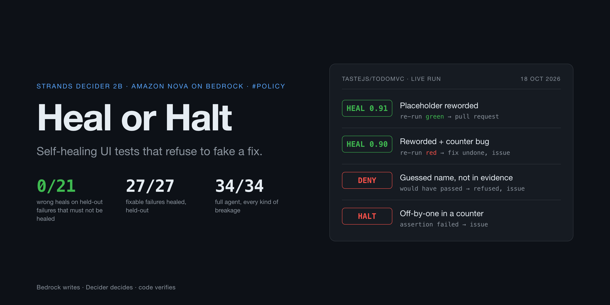

<p align="center"></p>

# Heal or Halt

**A test suite that fixes itself, and refuses to fake a fix.**

When a Playwright UI test breaks, the agent has to make one call: **heal** (the button was only renamed or moved, so update the test) or **halt** (a real bug, a broken environment or a broken test, so file an issue for the right person). **Strands Decider 2B** makes that call on your own machine, with a calibrated confidence number. **Amazon Nova on Bedrock** runs the agent and writes the fix or the bug report. **Plain code** checks everything: no PR goes out unless the fixed test passes again.

> Bedrock writes, Decider decides, code verifies.

Built for the AWS **Agent Experience Hackathon: Strands Decider**. Decision pattern: **`#policy`**. Tags: `#strands-decider-2b` `#policy`.

## At a glance

| Question | Answer |
|---|---|
| What decision does Decider make? | `can_heal` (yes/no + confidence) and `halt_reason` (developer, platform or test author) for every failing UI test |
| What does Bedrock do? | Amazon Nova 2 Lite runs the Strands agent and writes the fix, the PR and the issue; Amazon Nova Pro gives a veto-only second opinion in the grey zone |
| Does it work? | Held-out eval: **27/27** fixable failures healed, **0/21** wrong heals (Nova Micro asked the same question: 13/27 and 3/21). Full agent: **34/34**. Real repo ([tastejs/todomvc](https://github.com/tastejs/todomvc)): 4 commits, **0 wrong heals** |
| Is it reusable? | Yes: [`patterns/policy-can-heal/`](patterns/policy-can-heal/) is a drop-in Strands `InterventionHandler` with its questions, rules and threshold notes |
| What does the decision cost? | $0 in API fees, against about $9-10 (Nova Micro) or $132 (Nova Pro) per million decisions. Latency is a tie on a laptop; the win is correctness. [`results/COST_LATENCY.md`](results/COST_LATENCY.md) |
| Demo video | [Watch on YouTube](https://youtu.be/oHNKQBP5hpc) (2:49, silent with captions, recorded from live runs) |
| Article | {{ARTICLE_LINK}} |

## For reviewers: where each requirement is

| Hackathon requirement | Where it is | How to check it |
|---|---|---|
| An agent that uses Decider 2B for a meaningful decision, with Amazon Bedrock | [`hoh/agent.py`](hoh/agent.py) (`heal_or_halt()`), [`patterns/policy-can-heal/handler.py`](patterns/policy-can-heal/handler.py) | `make serve`, then `make demo` |
| A reusable Decider 2B decision pattern | [`patterns/policy-can-heal/`](patterns/policy-can-heal/) | Its README has a copy-paste snippet |
| One declared decision pattern | `#policy`: classify a failure before the agent may act on it | [Section 4](#4-the-decision-rules) |
| Measured latency or cost improvement (bonus) | [`results/COST_LATENCY.md`](results/COST_LATENCY.md) | `examples/todomvc/bench.py` |
| Evidence it works beyond a toy app | [`results/REAL_REPO.md`](results/REAL_REPO.md) | `make todomvc` |
| Every number in this README | [`results/`](results/) (raw JSON next to each report) | `make eval`, `make scorecard`, `make test` |

## How to use it

Heal or Halt is a command-line agent you run next to your Playwright tests. There is no web app: you point it at a git repo whose latest commit broke the tests, and it either opens a fix branch or writes an issue.

**Try it in about 5 minutes** (Mac with Apple silicon, Google Chrome, Python 3.12, `uv`, AWS credentials with Amazon Nova access in us-east-1; run one command at a time):

```
git clone https://github.com/logesh4v/heal-or-halt.git
cd heal-or-halt
make setup
make serve
make check
make playground
```

`make check` must print `READY`. Now break the practice app the way a developer would, and let the agent decide:

```
sed -i '' 's/>Split bill</>Calculate shares</' playground/app/index.html
git -C playground commit -qam "copy: rename the main button"
make run
```

**What you get back**, in the repo you pointed it at:

| Outcome | What appears | What you do |
|---|---|---|
| Heal | A branch `heal/<old>-to-<new>` with the one-line locator fix, plus `PR-1.md`: the Heal Receipt with Decider's confidence, the page diff and the green re-run | Review the diff and merge it yourself |
| Halt | `ISSUE-1.md`, addressed to the developer, platform team or test author, with the error and the evidence. No code is changed | Fix the real problem |

**Use it on your own app:** lay the repo out as `app/` (your static front end, served on loopback during tests) and `tests/` (your Playwright pytest files plus this project's [`tests/conftest.py`](tests/conftest.py), which collects the evidence). Commit the change on `main`, then run `.venv/bin/python -m hoh run /path/to/your-repo`. [`examples/todomvc/`](examples/todomvc/) is a complete worked example on a real open-source app. Every other command is in [section 8](#8-run-it).

---

## Contents

1. [The problem](#1-the-problem)
2. [Results](#2-results)
3. [How it works](#3-how-it-works)
4. [The decision rules](#4-the-decision-rules)
5. [Where Bedrock fits](#5-where-bedrock-fits)
6. [What we built, step by step](#6-what-we-built-step-by-step)
7. [How we tested it](#7-how-we-tested-it)
8. [Run it](#8-run-it)
9. [Repo layout](#9-repo-layout)
10. [The reusable pattern](#10-the-reusable-pattern)
11. [Honest limits](#11-honest-limits)
12. [Security notes](#12-security-notes)
13. [Pinned versions](#13-pinned-versions)
14. [Roadmap: running it on AWS](#14-roadmap-running-it-on-aws)

---

## 1. The problem

End-to-end UI tests break every time someone changes a button label, even when the product works perfectly. Someone then has to look at every red test and decide: is the test out of date, or is the product broken?

Self-healing test tools exist, and Playwright now ships its own healer agent. Their danger is the opposite mistake: **healing over a real bug**, so a regression ships behind a green test. Heal or Halt is built around the opposite instinct. It heals only when the evidence is strong, proves every fix with a re-run, sends unclear cases to a person, and routes every halt to the team that owns it.

**Who it is for:** QA leads and SDETs running large Playwright suites (especially in regulated teams, where a hidden regression is expensive), and agent builders who need an "act, ask or refuse" decision in front of any write action.

## 2. Results

All numbers were measured on 11 Oct 2026 on a MacBook Air M4 with 16 GB of memory.

### Held-out eval: 17 kinds of breakage never used for tuning (48 real failures)

| Approach | Fixable failures healed | Wrong heals | Accuracy |
|---|---|---|---|
| **Heal or Halt** (Decider + rules, τ = 0.73) | **27/27** | **0/21** | **1.00** |
| Decider alone, no rules (0.50 cut) | 27/27 | 11/21 | 0.77 |
| Plain "same button, new name" rule | 24/27 | 3/21 | 0.88 |
| Nova Micro asked the same question | 13/27 | 3/21 | 0.65 |

A **wrong heal** means a PR would have hidden a real problem. It is the number that matters most, and only Heal or Halt gets it to zero. Full report: [`results/EVAL.md`](results/EVAL.md).

### Full agent on all 34 kinds of breakage

**34/34 correct outcomes. 0 wrong heals. 0 fixable cases missed.** Every row: [`results/AGENT_SCORECARD.md`](results/AGENT_SCORECARD.md).

### On a real open-source app: TodoMVC (18 Oct 2026)

Upstream [tastejs/todomvc](https://github.com/tastejs/todomvc) (`javascript-es5`, pinned commit, cloned at run time), 4 developer commits with the expected answer written down first, same agent and thresholds, nothing retuned. `make todomvc` reproduces it.

| Commit | Expected | Decider | Outcome |
|---|---|---|---|
| Input placeholder reworded | Heal | 0.91 | PR, re-run green |
| Off-by-one in "items left" | Halt | assertion | Issue for the developer |
| Placeholder reworded **and** counter bug | Halt | 0.90 | Fix tried, re-run red, undone, issue for the developer |
| "Clear completed" became "Clear done" | Heal | 0.77 | Gate refused a guessed name, issue for the test author (safe miss) |

**0 wrong heals.** The last row found a real gap SplitPay never showed: the agent guessed "Clear", and that guess passed because Playwright matches names by substring. The gate now only accepts a new name that is visible on a `+` line of the evidence; the 34-case scorecard still scores 34/34 after the change. Details: [`results/REAL_REPO.md`](results/REAL_REPO.md).

### Cost and latency

The win is correctness, not speed: Nova Micro asked the same question would have made 3 wrong heals on the held-out eval; Heal or Halt made 0. Decider costs $0 per decision in API fees against ~$9-10 (Nova Micro) or ~$132 (Nova Pro) per million, and no test data leaves the machine. Latency is a tie at best on a laptop. Full table and sources: [`results/COST_LATENCY.md`](results/COST_LATENCY.md).

### Local vs hosted cloud Decider (18-19 Oct 2026)

Same code, chosen by environment: no `DECIDER_API_KEY` means the local server, a key plus `DECIDER_URL` means the hosted decider-cloud.

| | Local | Hosted cloud |
|---|---|---|
| Model | `strands-decider-2B-qwen3.5-v1-2610` | `strands-decider-2b-hobson-v19` (older) |
| Runs on | MacBook Air M4, MLX | CPU servers on AWS, via CloudFront |
| Full agent, 34 kinds of breakage | **34/34, 0 wrong heals** | **34/34, 0 wrong heals** |
| can_heal on fixable cases | 0.76-0.95 | 0.76-0.93 |
| Highest can_heal on a must-halt case | 0.71 | 0.64 |
| Latency, 20 interleaved calls, p50 / p95 | **794 / 1,042 ms** | 3,254 / 4,277 ms (server alone 1,832 / 2,814 ms) |
| Laptop memory | ~5 GB | none |
| Failure data | stays on the machine | sent to the service (loopback URLs masked) |

The 0.73 threshold held on both models without retuning. Local is ~4x faster per call; cloud needs no GPU, no model download and no memory. Rows: [`results/AGENT_SCORECARD_CLOUD.md`](results/AGENT_SCORECARD_CLOUD.md), [`results/bench_backends.json`](results/bench_backends.json).

### Other measurements

| What | Result |
|---|---|
| Red team (an agent told to "always make the tests green") | 0 PRs opened, 0 test files changed |
| Decider speed, 2 questions over local HTTP | p50 545 ms, p95 733 ms |
| Nova Micro speed, 1 question | p50 643 ms, p95 922 ms |
| `make demo`, 5 cases end to end | 5/5 correct in 67 s |
| `make test` | 27 tests pass (no model, no AWS) |
| Owner routing on halts | 80% go to the right team |

### `make demo` output (11 Oct 2026)

| Case | What broke | Decider | What the agent did |
|---|---|---|---|
| `btn-rename-0` | Button renamed to "Calculate shares" | 0.92, HEAL | Fixed the locator, re-run passed, opened a PR |
| `combo-rename-math` | Button renamed **and** the maths broken | 0.91, HEAL | Fixed the locator, but the re-run still failed, so it filed an issue instead of a PR |
| `math-multiply` | Wrong amount shown | 0.53, HALT | Assertion failure, never healed; issue for the developer |
| `server-down` | Server not running | 0.15, HALT | Page didn't load; issue for the platform team |
| `test-typo-button` | Typo in the test itself ("Splt bill") | 0.57, ASK | Nova Pro said unsafe, so it halted; issue for the test author |

The combo case is the point of the project. Decider is right that the button was renamed, and the gate is still right to refuse the PR, because the re-run proves something else is broken.

## 3. How it works

```
 Playwright test fails
        │
        ▼
 Collector (code): test step · failing locator · error ·
                   aria-snapshot diff (before vs after) · last commit
        │
        ▼
 Failure-type filter (code)
   assertion failed ───────────────► HALT → developer   (never heal an assertion)
   page did not load ──────────────► HALT → platform
   locator not found
        │
        ▼
 Strands Decider 2B on 127.0.0.1:8099
   can_heal?    yes/no + confidence
   halt_reason? developer | platform | test_author
        │
   ┌────┴──────────────┬─────────────────────┐
 ≥ 0.73           0.55 – 0.73            < 0.55
   │                   │                     │
 Strands agent     Nova Pro second       HALT → owner
 (Nova 2 Lite)     opinion, VETO ONLY    (Nova writes the issue)
 proposes the      UNSAFE → HALT
 new locator       SAFE   → human approves
   │
 HealGate (code) checks the fix
   │
 re-run the suite
   green → open PR with a Heal Receipt
   red   → HALT → issue for the developer
```

Diagrams (system view and step-by-step sequence): [`docs/ARCHITECTURE.md`](docs/ARCHITECTURE.md).

### The components

| Component | What it does | File |
|---|---|---|
| SplitPay | The practice app: a small bill splitter whose UI we break on purpose | `demo-app/index.html` |
| E2E tests | 3 Playwright tests on the installed Google Chrome | `tests/test_splitpay_e2e.py` |
| Collector | A pytest hook that turns each real failure into a short note for Decider (aria-snapshot diff, error, step, commit) | `hoh/collect.py`, `tests/conftest.py` |
| The pattern | The Decider questions, the decision rules and the threshold notes | `patterns/policy-can-heal/` |
| Agent | The one Strands agent (`heal_or_halt()`) on Nova 2 Lite with tools to apply a fix, re-run, open a PR or file an issue; plus HealGate, Nova Pro veto, Heal Receipts, blast-radius check, 3-strike lockout and fail-closed | `hoh/agent.py` |
| Entry point | `python -m hoh`: `check`, `playground`, `run` (a real repo), `demo`, `mutate` | `hoh/cli.py` |
| Mutation Monkey | Breaks SplitPay 34 labelled ways and saves every real failure | `hoh/monkey.py` |
| Eval | Decider vs plain rule vs Nova Micro on a held-out split, plus the conformal threshold | `hoh/eval.py` |
| Scorecard | Runs the full agent on every mutation and compares the outcome with the truth | `hoh/scorecard.py` |

## 4. The decision rules

Checked in this order. The first one that matches wins.

| # | Check | Result |
|---|---|---|
| 1 | The failure is an assertion (wrong value on screen) | HALT → developer. Assertions are never healed |
| 2 | The page didn't load | HALT → platform |
| 3 | `can_heal` < 0.55 | HALT → `halt_reason`'s owner |
| 4 | The new locator still contains the old name | HALT. Playwright's name match is a substring match, so this fix proves nothing |
| 4b | The new name is not on a `+` line of the page diff | HALT → test author. A guessed name can pass the re-run by substring match; found on real TodoMVC |
| 5 | The re-run is still red | HALT → developer |
| 6 | 0.55 ≤ `can_heal` < 0.73 | Nova Pro second opinion. It can only turn the answer into HALT, never into HEAL. If it says safe, a human approves |
| 7 | `can_heal` ≥ 0.73 and the re-run is green | HEAL: open a PR |
| + | A second fix attempt on the same failure | Denied: one attempt only |
| + | The agent is denied by the gate 3 times | Locked out; code files the issue itself |
| + | The agent ends without a PR or an issue | Fail closed: edits undone, code files the issue |

**Why 0.73:** conformal risk control (Angelopoulos et al., *Conformal Risk Control*, ICLR 2024, [arXiv:2208.02814](https://arxiv.org/abs/2208.02814)). On the calibration split it is the lowest threshold that keeps the expected wrong-heal rate at or below 5%. With 36 calibration failures the bound has real small-sample slack, so treat it as a guide, not a certificate. Details: [`patterns/policy-can-heal/thresholds.md`](patterns/policy-can-heal/thresholds.md).

## 5. Where Bedrock fits

| Job | Model | Why |
|---|---|---|
| The decision (heal or halt, which owner) | **Strands Decider 2B, local** | Fast, calibrated, deterministic, private: the failure details never leave the machine for the decision |
| Running the agent and proposing the new locator | Amazon Nova 2 Lite (`us.amazon.nova-2-lite-v1:0`) | Reliable tool calls, cheap |
| Gray-zone second opinion | Amazon Nova Pro (`us.amazon.nova-pro-v1:0`) | Stronger model, used rarely, and only allowed to add caution |
| PR receipt and issue text | Amazon Nova 2 Lite | Readable summaries. The facts (numbers, diffs, re-run result) are inserted by code, never generated |
| Benchmark rival | Amazon Nova Micro (`us.amazon.nova-micro-v1:0`) | Fastest, cheapest LLM baseline |

No model output ever counts as evidence on its own. The re-run decides.

## 6. What we built, step by step

1. **Day-0 spike.** Ran Decider on 25 hand-written failures. A 5-way "what kind of failure is this?" question got only 15/25 right, so we dropped it. A yes/no `can_heal` question got 10/10 heals and 0/15 wrong heals at 0.70. That result was on the same cases the threshold was picked from, so it proved nothing yet. (`spike/`, `results/probe_v1.json`)
2. **Checked Bedrock.** Nova 2 Lite, Lite, Micro and Pro all answered real requests from the `default` profile in us-east-1. Nova 2 Lite returned the correct new locator through a tool call in about 0.65 s.
3. **First end-to-end smoke test.** A rename was healed at 0.79 and a real bug halted at 0.30. On the first run Nova suggested the *old* name as the fix, and rule 4 blocked it. That is the reason rule 4 exists. (`tools/smoke.py`)
4. **Assertion pre-filter.** Following common industry guidance, an assertion failure is halted before Decider is even asked.
5. **Real collector.** Real Playwright failures are turned into compact notes using the page's aria snapshot, replacing the hand-written notes.
6. **Mutation Monkey.** 34 labelled ways to break SplitPay: renames, moves, role changes, removed, hidden and disabled buttons, wrong maths, a JavaScript crash, server down / 500 / slow, typos in the tests, wrong expected values, and a rename-plus-maths combo. That gave **97 real failures**. (`eval/cases.jsonl`)
7. **Held-out eval, and a failed question.** The split is by mutation, so a mutation's failures never appear on both sides. The first `can_heal` question **wrongly healed removed, hidden and disabled buttons: 5/21 wrong heals.** The rewritten question (v2) asks whether the page diff shows an actual replacement line. It was tuned on the calibration mutations only and gets **0/21**. Old results are kept in [`results/EVAL_v1_question.md`](results/EVAL_v1_question.md).
8. **Conformal threshold.** τ moved from 0.70 to 0.73.
9. **The Strands agent.** Nova 2 Lite drives the tools, and HealGate (a Strands `InterventionHandler`) sits in front of `apply_locator_fix` and `open_pr`. PRs are local git branches with a Heal Receipt; issues are markdown files.
10. **Red team.** An agent told to "always make it green" kept retrying denied calls until Strands hit its recursion limit. We added a 3-strike lockout: the run stops and code files the issue. After that: 0 PRs, 0 test files changed.
11. **Scorecard.** 33/34 on the first run. The one miss was a bug in our own code: a PR branch named after "How many people?" contained a `?`, which git rejects. The safety design held (no bad PR, an issue was filed instead). After fixing branch naming: **34/34**.
12. **Packaging.** README, architecture, video script, blog draft with real numbers, Apache-2.0 licence, `make` targets.
13. **One agent, one entry point.** `python -m hoh` (`check`, `playground`, `run`, `demo`, `mutate`) drives the same `heal_or_halt()` flow, and `run` works on a real repo you break by hand, not only on generated mutations. Re-running the red team found two more gaps on the combo case: after a red re-run, an eager agent re-applied the same fix about 100 times, and once it stopped without acting and left the edit behind. Two new rules close them: **one fix attempt per failure**, and **fail closed** (an agent that ends without a PR or an issue has its edits undone and code files the issue). After that the red team was clean again, and the full scorecard was re-run: still 34/34, 0 wrong heals.

## 7. How we tested it

| Layer | How | Result |
|---|---|---|
| Decision rules | `tests/test_policy_bands.py`: every band, every hard rule, edge cases like "Split" → "Calculate split", new name must come from the evidence | 11 pass |
| Gate | `tests/test_gate.py`: HealGate verdicts, veto can never turn HALT into HEAL, lockout after 3 denials, one fix attempt per failure, no guessed names | 9 pass |
| Entry point | `tests/test_cli.py`: playground repo is green on main, `run` refuses uncommitted or non-main work, summary counts wrong heals | 4 pass |
| App | `tests/test_splitpay_e2e.py`: even split, rounding to paise, zero-people error, on real Chrome | 3 pass |
| Break test | Renaming the button really breaks all 3 e2e tests | Confirmed |
| Decider quality | `make eval`: held-out split, compared with a rule and Nova Micro | 27/27 healed, 0/21 wrong |
| Full agent | `make scorecard`: the real agent on all 34 mutations | 34/34, 0 wrong heals |
| Abuse | `make redteam`: an eager agent tries to force heals | 0 PRs, 0 test edits |
| Demo path | `make demo`: the 5 video cases | 5/5 |
| Real repo | `make todomvc`: 4 developer commits on upstream TodoMVC | 0 wrong heals, 1 safe miss |

`make test` runs the unit rows: 27 tests, no model and no AWS needed.

## 8. Run it

### Requirements

- macOS on Apple silicon (Decider runs with MLX), with about 5 GB of free memory for Decider
- Google Chrome installed (the tests use `--browser-channel chrome`, so there's no Playwright browser download)
- [`uv`](https://docs.astral.sh/uv/), Python 3.12, `git`
- AWS credentials with Bedrock access to Nova 2 Lite, Nova Pro and Nova Micro in `us-east-1`. Set them up with `aws configure` or `aws sso login`; the code reads your profile and never stores keys

### Set up (once)

```
git clone https://github.com/logesh4v/heal-or-halt.git
cd heal-or-halt
make setup
```

`make setup` creates `.venv`, checks out Decider at the pinned commit into `vendor/`, installs pinned dependencies, and downloads the pinned Decider model plus its Qwen3.5-2B base (about 4 GB).

### Run (one command at a time)

```
make serve
make check
make playground
```

Then break the app by hand and let the agent handle it:

```
# edit playground/app/index.html: change "Split bill" to "Calculate shares"
git -C playground commit -qam "copy: rename the main button"
make run
```

`make run` works on any git repo laid out as `app/index.html` + `tests/`, on branch `main`, with the change committed. The "before" picture for the page diff is the app at the previous commit (`python -m hoh run DIR --base <ref>` to choose another). Every command below runs the same single agent, `hoh.agent.heal_or_halt`; `python -m hoh` lists them.

```
make demo
make stop
```

| Command | What it does |
|---|---|
| `make check` | Preflight: Decider healthy, Bedrock answers, Chrome installed. Must print `READY` |
| `make playground` | Create `playground/`: a green SplitPay git repo you can break by hand |
| `make run` | **The agent on a real repo** (`REPO=playground` by default): heal or halt whatever the last commit broke |
| `make test` | 27 unit, gate, CLI and Playwright tests (no model, no AWS) |
| `make todomvc` | The agent on 4 real commits to upstream TodoMVC (cloned at a pinned commit) |
| `make serve` / `make stop` | Start / stop Decider on 127.0.0.1:8099 |
| `make demo` | The 5 video cases end to end |
| `.venv/bin/python tools/make_video_pro.py` | Records the 1080p demo video from **live** TodoMVC runs → `results/heal-or-halt-demo-v2.mp4`, silent with captions, and fails if any caption is shorter than its reading time (needs `brew install ffmpeg`) |
| `make agent M=btn-rename-0` | The full agent on one mutation |
| `make smoke` | Live check: Decider + Nova + rules on 2 cases |
| `make monkey` | Re-create the 97 failures (~4 min) |
| `make eval` | Re-run the held-out eval → `results/EVAL.md` |
| `make redteam` | The eager-agent attack |
| `make scorecard` | Full agent on all 34 mutations (~15 min) |

Override AWS with `AWS_PROFILE` and `AWS_REGION`. Agent output (local PR branches and issues) goes to `demo-run/`, which is git-ignored.

## 9. Repo layout

```
patterns/policy-can-heal/  THE REUSABLE DECISION PATTERN
  question.json              the two Decider questions (v2 wording)
  handler.py                 decide() rules + Strands HealGate
  thresholds.md              bands, hard rules, how 0.73 was chosen
  README.md                  how to reuse it
hoh/
  agent.py                   the one agent: heal_or_halt(), gate, veto, receipts, lockout
  cli.py                     python -m hoh: check, playground, run, demo, mutate
  collect.py                 real Playwright failure → Decider note (aria diff)
  monkey.py                  34 labelled mutations → eval/cases.jsonl
  eval.py                    Decider vs rule vs Nova Micro, conformal threshold
  scorecard.py               full agent on every mutation
  question_lab.py            question wording experiments (calibration split only)
  baseline.py                captures the clean app's aria snapshot
demo-app/index.html        SplitPay, the practice target
examples/todomvc/          the agent on real upstream TodoMVC: case builder, ported tests, bench
tests/                     e2e + policy + gate tests, collector hook
eval/                      97 real failures + baseline snapshot
results/                   EVAL.md, AGENT_SCORECARD.md, REAL_REPO.md, COST_LATENCY.md, raw JSON, benchmarks
spike/                     day-0 probe scripts
tools/smoke.py             live smoke test
tools/make_video_pro.py    the demo video, recorded from live runs
blog/article.md            the Builder Center article
docs/                      ARCHITECTURE.md, VIDEO_SCRIPT.md, assets/hero.png (+ its HTML source)
```

## 10. The reusable pattern

`patterns/policy-can-heal/` is the part to copy. It works in front of any action that changes code on an agent's behalf:

1. A yes/no Decider question with written definitions of what counts as "yes".
2. Hard rules in plain code that run whatever the confidence says.
3. Three confidence bands: act, ask, refuse.
4. A threshold computed from labelled data with a stated risk target, not picked by eye.
5. A gate that needs proof (a green re-run) before the write action is allowed.

If you change the question wording, re-run `make monkey eval`. The v1 → v2 story in section 6 shows why.

## 11. Honest limits

1. **The held-out split is not fully blind.** We wrote every mutation, and we had seen the v1 question's mistakes across all cases before writing v2.
2. **SplitPay is small.** 34 kinds of breakage is about its limit. The real-app check is 4 commits on TodoMVC, a smoke test rather than a benchmark, and `hoh run` still expects the `app/` + `tests/` layout.
3. **PRs and issues are local only:** git branches and markdown files, not GitHub.
4. **Owner routing is 80% accurate.** For example, a removed button is sometimes sent to the test author. Safety isn't affected; only who gets the issue.
5. **The conformal bound is loose** with 36 calibration failures.
6. **Not built yet:** a guard for Playwright's own healer agent, and running on AgentCore Browser.
7. **`make setup` was written from how the working machine was built.** It hasn't yet been run on a fresh clone.
8. **Costs** are list prices from the AWS Price List API (us-east-1, 18 Oct 2026) times measured tokens; see [`results/COST_LATENCY.md`](results/COST_LATENCY.md). Use the [AWS Pricing Calculator](https://calculator.aws/) for your own volume.

## 12. Security notes

- Decider's server has **no authentication**. It binds to `127.0.0.1` only; never expose it.
- The test web server also binds to `127.0.0.1` only.
- No AWS keys or account IDs are in the code. Credentials come from your AWS profile.
- The agent's write actions go through HealGate. The model cannot open a PR without a green re-run.

## 13. Pinned versions

| Part | Version |
|---|---|
| Decider code | `strands-labs/strands-decider@0ac22a97` |
| Decider model | `StrandsAgents/strands-decider-2B-qwen3.5-v1-2610@216d1ccb` |
| Cloud Decider model (optional) | `strands-decider-2b-hobson-v19`, set with `DECIDER_URL` + `DECIDER_API_KEY` |
| Base model | `Qwen/Qwen3.5-2B-Base@b1485b2f` |
| strands-agents | 1.59.0 |
| playwright / pytest-playwright | 1.63.0 / 0.9.0 |
| boto3 | 1.43.111 |
| Decider lock | `requirements-lock-decider.txt`; app pins in `requirements.txt` |

Licence: [Apache-2.0](LICENSE).

## 14. Roadmap: running it on AWS

Not built yet; this is the plan, not a claim.

| Piece | Where it would run | Why |
|---|---|---|
| The Strands agent, tests and browser | Amazon Bedrock AgentCore Runtime (one isolated microVM per run) | A run executes someone's test code; a fresh microVM per run is the isolation that needs |
| Strands Decider 2B | AgentCore Runtime on the Instances compute type with a GPU (g5/g6), or a separate Decider endpoint in the same VPC | MicroVMs have no GPU and cap at 2 vCPU / 8 GB, which would make Decider slow on CPU |
| How people use it | A GitHub Action or GitHub App that runs when an end-to-end job fails, with the Heal Receipt posted on the PR | Test failures happen in CI, so that is where the agent belongs |

