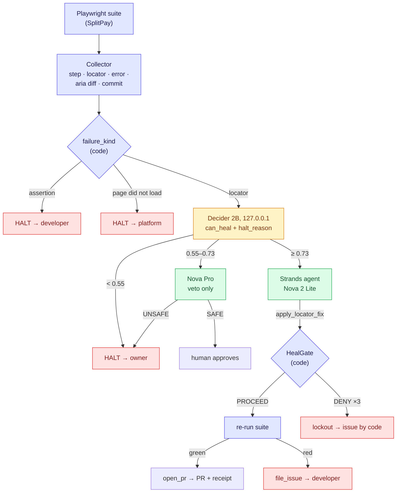
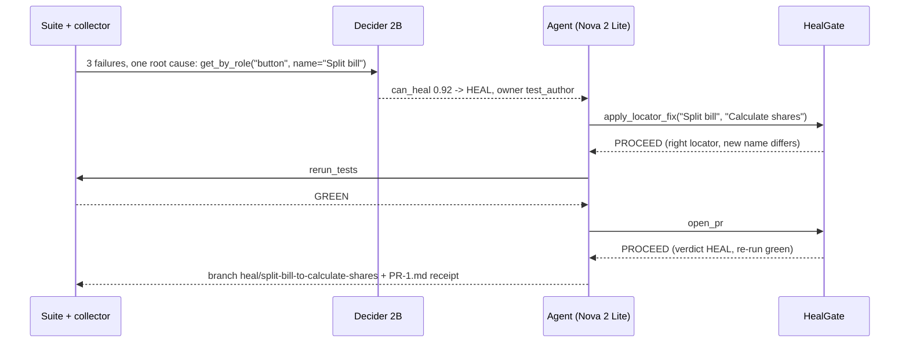

# Heal or Halt: architecture

**Bedrock writes, Decider decides, code verifies.**

## 1. The whole system

Blue = deterministic code. Amber = the decision (local). Green = Amazon Bedrock. Red = halt.

## 2. One heal, start to end (measured: btn-rename-0)

The combo case follows the same path until the re-run: it comes back RED (the maths is wrong too), the gate refuses `open_pr`, and the agent files an issue for the developer.

## 3. The rules (patterns/policy-can-heal/handler.py, hoh/agent.py)

| Check, in order | Result |
|---|---|
| Assertion failure | HALT, developer. Assertions are never healed |
| Page did not load | HALT, platform |
| can_heal < 0.55 | HALT, `halt_reason`'s owner (test_author when the page did not change at all) |
| New locator still contains the old name | DENY |
| Fix targets a locator other than the failing one | DENY |
| 0.55 ≤ can_heal < 0.73 | Nova Pro second opinion; UNSAFE → HALT, SAFE → human |
| can_heal ≥ 0.73 | the agent may fix |
| Re-run not green | `open_pr` DENIED |
| 3 healed locators in one commit | DENY, likely redesign (blast radius) |
| 3 denied attempts in one case | lockout, case halted by code |

## 4. Security

- The Decider server has no auth: bound to 127.0.0.1 only. The demo app server too.
- AWS: boto3 reads the named profile; no keys in code (scanned).
- The agent's "PRs" and "issues" are local git branches and markdown files under `demo-run/`; nothing is pushed.
- The receipt's facts (decision, diff, re-run result, commit) are inserted by code; the model writes only the prose.
